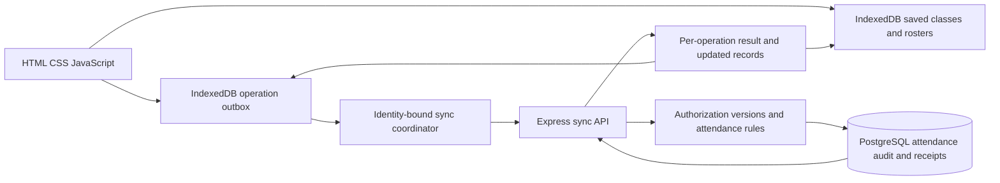

# SAMS realism and offline synchronization review

Reviewed on 11 November 2026. This is an investigation and proposed implementation plan, not a claim that the proposed capabilities already exist. Application code was not changed for this review.

Subsequent implementation: Phase 1 addresses the queue identity, retry, replacement, cross-tab and local acknowledgement findings below. This document preserves the inspected baseline; see [the phase status](WEB_IMPROVEMENT_PHASES.md) and [current architecture](TECH_ARCHITECTURE.md) for implemented behavior. Lecturer offline marking and server operation receipts remain proposed Phase 2 work.

## 1. Purpose and current foundation

SAMS is a class attendance register for students, lecturers and the registrar. A lecturer conducts a dated class, students check in, the lecturer resolves exceptions, and the registrar obtains a traceable attendance report. Attendance qualification is only one input to examination clearance.

The current JavaScript implementation has a useful foundation: Express APIs, PostgreSQL relations and migrations, runtime validation, course ownership and enrollment checks, short-lived check-in codes, unique attendance records, transactional session locks, audited corrections, and reports based on completed classes. Keep this structure. Offline support does not require TypeScript, React, Firebase, microservices or a native application.

The harder remaining problem is preserving the meaning of an official register when work happens on disconnected devices. Saving a request is a transport capability; deciding whether it is valid attendance is a separate business decision.

## 2. Repositories inspected

Source snapshots cloned locally and inspected:

| Repository | Reviewed commit | Observation |
|---|---|---|
| [mylectures](https://github.com/mugmarp/mylectures/tree/b5b633f7c632ac33dfdc5ef1d488b7034725e012) | `b5b633f7c632ac33dfdc5ef1d488b7034725e012` | Android/Kotlin/Compose application using Room and optional Firestore synchronization |
| [mylectures-2](https://github.com/mugmarp/mylectures-2/tree/62a6e27fbdd0b13b109fa86861207bf671852f59) | `62a6e27fbdd0b13b109fa86861207bf671852f59` | Same core timetable application with changes to notifications, updater, notes and other screens |

They are closely related, but their checked-out trees are not identical: 32 files differ under `app/src/main`. Their timetable JSON and metadata are byte-identical, as are the core `SyncRepository.kt` and `SyncConflictResolver.kt` files in that directory comparison. The timetable worker differs. Reviewing both does not provide two independent datasets or independent synchronization implementations.

### Borrow these ideas

| Source pattern | Useful SAMS adaptation |
|---|---|
| Room database and repository reads through `TimetableRepository` | Render saved sessions and authorized rosters from IndexedDB immediately; refresh separately |
| Program/cohort matching and `shared_with` | Suggest timetable-to-offering mappings for registrar review; represent shared teaching explicitly |
| Bundled timetable and metadata | Import a versioned reference timetable; retain source identity and provenance |
| Stable client UUIDs, user ownership and deletion markers in personal-data models | Give every queued operation a stable ID and actor; retain deletion/change information for synchronization |
| Network-constrained WorkManager scheduling | Use reconnection, application startup and explicit retry to drain a durable browser outbox; native scheduling itself cannot be copied into a web app |
| Non-destructive handling of note conflicts | Preserve conflicting attendance proposals for review instead of silently overwriting official records |

Relevant source: [TimetableRepository](https://github.com/mugmarp/mylectures/blob/b5b633f7c632ac33dfdc5ef1d488b7034725e012/app/src/main/java/com/lectures/features/timetable/data/TimetableRepository.kt), [sync repository](https://github.com/mugmarp/mylectures/blob/b5b633f7c632ac33dfdc5ef1d488b7034725e012/app/src/main/java/com/lectures/core/sync/SyncRepository.kt), [conflict resolver](https://github.com/mugmarp/mylectures/blob/b5b633f7c632ac33dfdc5ef1d488b7034725e012/app/src/main/java/com/lectures/core/sync/SyncConflictResolver.kt).

### Do not copy these behaviors without redesign

`TimetableRepository.refreshTimetable()` only writes a formatted last-sync time; it does not fetch timetable rows. The inspected `TimetableSyncWorker` detects and persists metadata and handles update notifications; that path does not replace the teaching timetable rows. A label saying “Synced” must follow a successful data transaction, not merely a refresh click or metadata check.

The personal-event/task resolver uses device `updatedAt` timestamps to choose the latest record. That may be acceptable for preferences, but a device with a fast clock must not overwrite an official attendance correction. Attendance needs server versions, authorization checks and explicit conflict handling.

Several cloud push methods catch exceptions with an `offline queue` comment. The SDK may provide its own pending writes, and full-user sync performs reconciliation, but the comment alone is not an application-level durable operation ledger with visible acknowledgements. SAMS should implement and test those guarantees explicitly.

Keep notes, assignment planners, vacant-room discovery and APK updating outside the attendance scope. The inspected `mylectures` README says “All rights reserved”; no permissive top-level license was found. This review recommends independently implementing the useful patterns. Direct source or asset reuse should reflect the owner's intended permission and retain provenance.

## 3. Timetable data needs review before becoming a register

The shared export contains 1,304 rows and 1,304 unique natural keys. These are weekly timetable entries, not 1,304 dated classes that actually took place.

Reproducible checks on `app/src/main/assets/timetable_export.json` found:

| Check | Result | Consequence |
|---|---|---|
| `time_slot` interval | All 1,304 span 60 minutes | It may identify a source table slot rather than the full teaching interval |
| `time_slot` end versus `end_time`, compared as minutes | 1,152 disagreements | Do not silently assume which interval is authoritative |
| Empty lecturer | 141 rows | Cannot automatically establish account ownership |
| Empty room | 47 rows | Permit unknown room without inventing one |
| Empty session type | 1,227 rows | Require an explicit import policy rather than claiming known teaching type |
| Nonempty `shared_with` | 636 rows | Shared teaching needs deliberate mapping and deduplication |

For example, `MTH7101` Thursday has `time_slot: 11:00-12:00` but `end_time: 13:00`. This is an ambiguity to resolve against the source, not proof that either value is wrong. Metadata labels the academic year `2026/2027`, but `last_updated: 1728518400000` means 10 October 2024 UTC. Its “Official Final” text is a dataset claim, not independently verified institutional approval.

Use an import preview with rejected/ambiguous rows, reviewed staff mappings and an approved source version. Expand weekly templates into real dates using confirmed semester start/end dates, teaching weeks, holidays, cancellations and makeup classes in `Africa/Kampala`. Never infer semester dates from today's date or count a timetable slot as completed attendance.

Maintain immutable SAMS session IDs separately from source natural keys. A room/time correction must not orphan attendance or create a duplicate class. Preserve imported source keys and publication versions as references. Student program selection may filter a timetable; it must not authorize enrollment.

The historical `MUST_SYSTEMS_INTEGRATION.md` describes the export as ready to import. Its historical warning remains important: the current importer/specification and the ambiguities above take precedence over those earlier assumptions.

## 4. What SAMS currently does offline

Inspected code: `frontend/public/sw.js`, `frontend/public/js/offline.js`, `student.js`, `api.js`, and `backend/src/services/attendance.js`.

| Scenario | Current behavior |
|---|---|
| Previously loaded app loses connectivity | Static HTML, CSS and JS can load from the service-worker cache |
| Student previously fetched classes/summary | Network-first reads can fall back to user-keyed snapshots, with a 24-hour TTL |
| Student submits without a network response | IndexedDB stores a pending attempt for that user/session |
| Reconnect while the student page is open | Startup, `online` event or the send button can replay pending attempts |
| Reconnect while the same code remains valid | A new attendance record can be accepted |
| Server accepted the first request but its response was lost | Existing code-based attendance is returned on retry, including after code expiry |
| First submission reaches server after code rotates/closes | Rejected; it is not counted using the device timestamp |
| Lecturer needs a roster and marking during an outage | No lecturer offline register is implemented |
| App is closed | No service-worker background sync handler is implemented |
| First visit or first login while offline | Not supported |

Therefore the accurate description is **cached access and queued student retries**, not complete offline attendance recording.

Example: a student saves a code at 10:01 and reconnects at 10:08. SAMS validates against the code active at 10:08. The original two-minute code will normally have expired. A ten-minute check-in window does not make each rotating code valid for ten minutes.

This rejection is safer than trusting an arbitrary client timestamp. A student can change the clock, edit IndexedDB, or obtain a code from another student. Even a server-signed challenge proves issuance and integrity, not physical presence or the time the student actually responded offline. A longer validity period changes the fraud window; it does not solve that evidence problem.

### Concrete queue weaknesses

1. **Account switching:** the queue is filtered using the original `userId`, but each API call reads the current token from shared `localStorage`. A different tab can change the signed-in account during a replay. The request body has no queue-owner binding; a later request could be evaluated as the new student. This is a code-path risk identified by inspection, not a reproduced exploit in this review.
2. **Transient server errors become permanent failures:** every non-network error, including a 429 or 5xx response, marks the attempt failed. Five transport failures also stop automatic retries, regardless of how long the outage lasts.
3. **No scheduled retry:** no persisted next-attempt time or backoff exists. An `online` event is only a connectivity hint; it does not prove the API is reachable.
4. **Weak operation identity:** the key is user plus session. A newer attempt overwrites the older one, resets its timestamp and retry count, and can race with deletion of a successfully sent older attempt.
5. **No cross-tab coordination:** the `syncing` boolean protects only one page instance. Server uniqueness protects the attendance row but cannot preserve the browser operation history.
6. **Acknowledgements disappear:** successful attempts are deleted immediately, leaving no durable local receipt explaining which operation the server accepted.
7. **Local durability is conditional:** storage failure, site-data clearing, private browsing and cache eviction need explicit handling. User-keyed data is organizational separation, not encryption or protection from another person controlling the same browser profile. Logout currently retains local snapshots and attempts.

## 5. Recommended offline contract

Use two explicitly different forms of evidence:

**Online student check-in:** keep short-lived code validation and enrollment checks. A transport retry of an already accepted request must remain safe.

**Offline lecturer register:** an authenticated lecturer prepares a specific dated class and roster while online, then records attendance against that saved roster during an outage. The application writes each action to IndexedDB before showing it as saved locally. After reconnection, the server validates and accepts it as an attributable lecturer declaration, subject to current policy and conflict checks. It is not independent proof of student presence.

**Delayed student claim:** when a code has expired, preserve the attempt as “Needs lecturer review.” Do not automatically turn it into PRESENT. A lecturer can approve or reject it with a recorded reason. This requires a server-side claim/review workflow; the current local failed-attempt message is not such a workflow.

The offline lecturer must have prepared the relevant roster/session beforehand. Offline cached identity is not a fresh login. Use a bounded preparation/authorization policy, and recheck account status, ownership, roster changes and session state at upload. A revoked or reassigned lecturer's offline work must be held or denied according to an agreed rule. Do not promise immediate remote revocation on a disconnected device.

If everyone is offline, student phones cannot communicate with the central API merely because a service worker exists. The lecturer register is the smallest useful fallback. Campus LAN/edge servers or device-to-device attendance could support another model, but introduce discovery, HTTPS, identity and reconciliation work and are outside the recommended first increment.

## 6. Proposed architecture

The local database supplies the screen immediately. PostgreSQL remains authoritative for accepted attendance and reports. Display local changes as provisional overlays; do not silently include unsynchronized marks in an official qualification percentage. This distinction allows a responsive local UI without giving disconnected devices authority over the official register. The same separation of local reads and network synchronization appears in [Android's offline-first architecture guidance](https://developer.android.com/topic/architecture/data-layer/offline-first); adapt the pattern to IndexedDB rather than importing Android frameworks.

Keep one Express application and one PostgreSQL database. Separate frontend modules for local repositories, outbox, synchronization and screens; separate server services for validation, decisions and reconciliation. No queue broker is needed for the first version.

### Durable operation protocol

Each operation needs an immutable random `operationId`, originating actor ID, device ID for diagnostics, session/student IDs, operation type and payload, base server version, untrusted device-observed time, local state, attempts and next retry time. The server records receipt time separately. Device IDs are not authentication credentials. Derive the authenticated actor from the token and verify that it matches the claimed origin; never authorize using the supplied actor ID.

Write an attendance draft and its outbox operation in one IndexedDB transaction. Keep a new operation ID for a new correction; never mutate an in-flight payload. Sequence related operations or explicitly reference their dependencies. Initially support offline marking of already-created, prepared sessions to avoid inventing temporary class IDs.

Proposed API additions, not existing routes:

- `GET /api/sync/bootstrap?sessionId=...`: authorized class, roster, versions, policy and server time; include only necessary personal data.
- `POST /api/sync/operations`: bounded validated batch, with an explicit result for every operation.
- An incremental changes endpoint using a server-issued cursor after the basic bootstrap/upload flow is reliable. Include deletions, cancellations and access changes; timestamps alone are insufficient cursors.

For each operation, authorize and validate, compare the expected record/session version, and atomically persist the attendance change, audit event and operation receipt. Enforce a unique authenticated actor/operation ID and a stored canonical payload hash. Replaying the same ID and payload returns the existing receipt; reusing the ID with different content returns a conflict. Keep the existing student/session attendance uniqueness constraint as well.

Return per-operation outcomes such as ACCEPTED, DUPLICATE, NEEDS_REVIEW, CONFLICT or DENIED, with meaningful codes and current versions. Successful HTTP transport does not imply that every operation in a batch was accepted. Independent operations may commit separately; preserve ordering for dependent changes.

The local state should distinguish SAVED_LOCALLY, WAITING_FOR_CONNECTION, SENDING, SYNCED, NEEDS_REVIEW, CONFLICT and DENIED. Update accepted records and receipts transactionally before pruning old outbox data. If the response is lost, retry the identical operation ID. If the server committed before a crash, its receipt makes the retry safe.

### Retry, identity and conflict rules

- Retry transport failures, timeouts, 408, 429 and appropriate 5xx responses with exponential backoff and jitter; honor `Retry-After`. Bound request size and frequency. Do not discard work after five ordinary network failures.
- Pause on expired authentication, refresh only for the same identity, and require reauthentication when necessary. Freeze/cancel replay on logout or cross-tab identity changes; atomically bind a replay to its originating account. Combine this with server actor checking.
- Treat validation/permission failures as actionable outcomes; send stale versions and changed class/enrollment state to conflict handling. Retry will not repair a permanent denial.
- Use a cross-tab lease or supported lock mechanism, with recovery after a crashed tab. Server idempotency remains necessary even with a client lock.
- Never resolve competing attendance statuses by device time. A cancellation, manual correction or changed roster can invalidate an earlier draft. Show the current server state and lecturer proposal for a deliberate resolution with an audit reason.
- Preserve pending work through cache/application updates. Test IndexedDB migrations. Request persistent storage where appropriate and surface save/quota failures before claiming a mark was saved. Browser storage is best-effort by default; persistence reduces eviction but cannot prevent user deletion. See [MDN storage lifecycle guidance](https://developer.mozilla.org/en-US/docs/Web/API/Storage_API/Storage_quotas_and_eviction_criteria).

Automatic synchronization should run when the app opens, regains focus/connectivity, and when the user selects Sync. Add service-worker Background Sync as an enhancement where supported, with a deliberate identity/authentication design; do not copy refresh credentials casually into caches. The current implementation depends on window APIs and localStorage, so it cannot simply run unchanged in a worker. Background Sync requires a secure context and has limited browser availability; reopening the app must remain a supported fallback. See [MDN Background Synchronization](https://developer.mozilla.org/en-US/docs/Web/API/Background_Synchronization_API).

## 7. Other improvements that make the register realistic

**Academic model:** the current Course is effectively a term-specific offering and supports one examiner. Add sections and multiple assigned lecturers only when required by a real pilot. Preserve the distinction between a course definition, an offering, a weekly template and an actual dated session. Effective enrollment dates matter: a student enrolled late should not automatically inherit every earlier absence. Do not remove historical attendance when a student drops a course.

**Policy:** confirm whether LATE and EXCUSED count and what threshold applies. Current PRESENT/LATE counting and EXCUSED exclusion are implementation rules, not verified university policy. Version the applicable policy and retain it in finalized reports so a later threshold change does not silently reinterpret an issued register. Keep missing records, explicit absence and unresolved claims distinguishable. Establish who can complete/reopen/correct a register and how a pending offline upload affects finalization; finalizing with unresolved work should require an explicit, visible decision.

**Audit:** retain actor, source, previous/new status, reason, server receipt time and relevant versions. Extend audit coverage to register completion, cancellations, roster changes and imports. Idempotent replay must not create duplicate correction events.

**Account and device lifecycle:** add account disabling, server-checked revocation/session lifecycle and controlled password recovery before wider deployment. Current JWT middleware trusts verified token claims without a current account lookup. Minimize cached rosters and provide deliberate local-data clearing with a warning about unsynchronized work. LocalStorage bearer tokens and shared browser profiles need an explicit production security decision.

**Operations:** deploy HTTPS, verify migrations on a populated database, test backup restoration, monitor failed syncs and database health, and distinguish synthetic records from real operational records during onboarding. PostgreSQL on a running local server is a real database connection; it is not evidence that public hosting or institutional integration has been completed.

## 8. Implementation order and acceptance evidence

| Order | Deliverable | Evidence required before moving on |
|---|---|---|
| 1 | Document current offline limits; correct queue identity and retry classification | Account switch cannot submit another user's operation; transient server errors stay retryable; queued replacement cannot be deleted by an older response |
| 2 | Preload one lecturer's dated class and roster; add local marking and durable outbox | Network disabled, reload app, saved marks survive; saving failures are visible; official totals stay separate |
| 3 | Server operation receipts, versions, transactional audit and replay | Lost response, duplicate batch and server restart cause one logical mark and one audit action; different payload under same operation ID conflicts |
| 4 | Conflict and delayed-claim review screens | Cancellation, concurrent correction, removed enrollment and reassigned lecturer produce explicit outcomes; no silent latest-timestamp overwrite |
| 5 | Timetable preview and reviewed expansion for one offering | Real approved semester dates, explicit ambiguous-row handling and repeatable import without duplicate classes |
| 6 | Pilot readiness | Mobile browser test, session expiry, two tabs, long outage, storage failure, app upgrade with pending work and backup restore are demonstrated |

Extend the Postman collection with invalid actors, malformed batches, permission denial, idempotency replay and stale versions. Browser tests must cover offline persistence and UI states; API tests alone cannot establish offline usability. Existing browser journeys cover a quick successful reconnect and a rejected closed code, not the complete design proposed here. This review did not rerun the application test suite or build either Android application.

For the assignment's 12 November 2026 deadline, retain the functioning core workflow and be precise about implemented offline support. Prioritize a small, verified lecturer-offline increment if time permits; do not present an untested synchronization design as delivered. The longer-term target is a limited real-class pilot, not extra unrelated modules.
