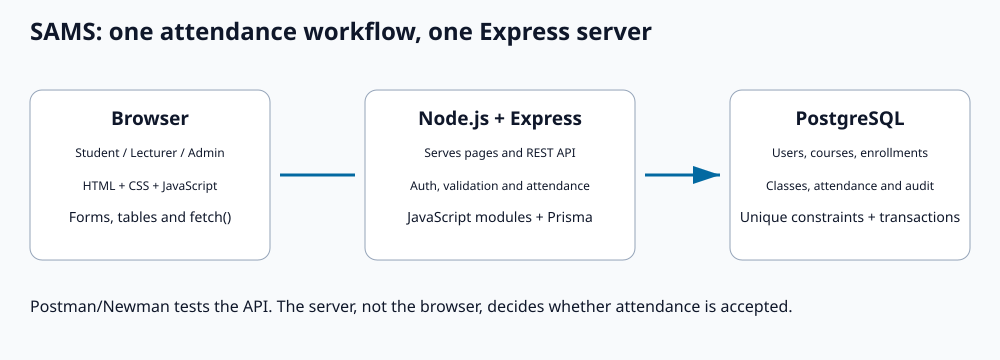

# JavaScript SAMS architecture

Express serves both the plain frontend and `/api`. A single origin avoids an extra frontend development server and keeps the fetch calls simple. PostgreSQL is the live persistent database; Prisma's JavaScript client provides transactions, relations and migrations. No TypeScript, JSX, React, Vite, Tailwind, Redis or nginx application layer is required.

## Responsibilities

- `frontend/public/*.html`: page structure, forms, tables, labels and accessible controls.
- `frontend/public/css/styles.css`: authored responsive presentation.
- `frontend/public/js/api.js`: fetch, bearer tokens, refresh and meaningful error handling.
- `common.js`: role-aware navigation, saved-session restoration, escaping and Kampala formatting.
- `examiner.js`, `student.js`, `admin.js`: page events, API requests and DOM updates.
- `offline.js`, `sw.js`: separate user-scoped IndexedDB attempts/snapshots and static app-shell caching.
- `backend/src/routes`: API schemas, role/resource access, setup operations and workflow endpoints.
- `backend/src/services`: authoritative attendance rules, transactions, reports and PDF output.
- `backend/prisma`: schema, committed migrations and repeatable synthetic seeding.
- `backend/scripts/import.js`: validated transactional local import.

## Check-in and reporting

Opening, closing, completing, cancelling, correcting and checking into a class lock the Session row in a transaction. Enrollment and ownership are checked on the server. The unique student/session constraint prevents duplicates, while identical code-based retries return the existing record. Students cannot overwrite manual corrections.

A random database-held secret and two-minute slot produce the current HMAC-derived code during a ten-minute window capped at class end. There are no process timers or secondary code stores to drift after a restart. Student responses omit code material. Lecturer pages poll code/roster every five seconds and hide codes at expiry.

Completed classes in one code/year/semester offering form the denominator; PRESENT/LATE form the numerator. The offering's configured threshold is compared against exact counts, then percentages are rounded for display. Zero completed classes returns null percentage and unassessed status. Reports include every enrolled student. Lecturer exports are ownership-scoped; administrators can report across offerings.

## Validation and security

Removing TypeScript removes development-time annotations, not runtime checks. Zod validates incoming JSON/IDs/dates/policies, Express middleware enforces JWT roles, bcrypt hashes passwords, database constraints enforce uniqueness and threshold bounds, and transactions serialize conflicting operations. Untrusted values are escaped before insertion into HTML. No password hashes or check-in secrets are returned to students. Proxy trust is disabled unless explicitly configured for one trusted proxy.

This remains a classroom prototype. Token revocation/recovery, institutional identity integration, approved retention and public hosting are separate operational requirements.

## Offline

The service worker caches static HTML/CSS/JS, never API responses. Safe student snapshots and attempts are stored separately, keyed by user. Snapshots expire after 24 hours. Each new attempt is saved before sending with an immutable local ID; a transactionally renewed IndexedDB lease coordinates replay across tabs. Temporary failures retain their next retry time with exponential backoff/jitter and Retry-After handling, while invalid/denied attempts require action. Successful attempts retain a local acknowledgement and discard the code. This is not yet the server operation-receipt protocol proposed for Phase 2. Expired codes are never accepted using a device timestamp. Authentication uses a per-sign-in record and active identity pointer. Logout leaves a terminal marker so a late refresh cannot reactivate that sign-in; refresh writes cannot replace another account’s active pointer. Requests capture their original credentials, and queued uploads send an originating-user consistency check enforced by the server. Logout clears active credentials, while user-scoped local data remains until site data is cleared. First-time offline login is not supported.
